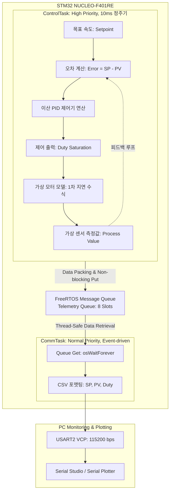

# NUCLEO-F401RE: FreeRTOS 기반 폐루프 PID 제어 시스템

STM32 NUCLEO-F401RE 보드와 FreeRTOS(CMSIS-RTOS V2)를 활용하여 정밀 주기 결정론(Determinism)을 보장하는 폐루프(Closed-Loop) PID 제어 시스템을 구축하는 프로젝트입니다.  
물리적 모터와 센서가 부재한 환경에서도 **소프트웨어 1차 지연 플랜트 모델(Plant Simulation)**을 제어 루프에 직결하여, 임베디드 실시간 OS의 아키텍처 원리와 피드백 제어기 응답 곡선을 PC 시각화 도구로 검증하도록 설계되었습니다.

---

## 🛠 개발 환경 (Development Environment)

- **Target Board**: STMicroelectronics NUCLEO-F401RE (ARM Cortex-M4 with FPU @ 84MHz, 512KB Flash, 96KB SRAM)
- **IDE / Toolchain**: STM32CubeIDE (v2.1.1) / GNU Arm Embedded Toolchain
- **OS / Middleware**: FreeRTOS (CMSIS-RTOS V2 추상화 계층 적용)
- **HAL Driver**: STM32F4xx HAL Driver (HAL Timebase: `TIM10` 전용 할당)
- **Visualization Tool**: Serial Studio / Arduino Serial Plotter (VCP UART @ 115200 bps)

---

## 📚 핵심 공학 이론 (Core Engineering Principles)

### 1. RTOS(Real-Time Operating System)의 본질과 실시간성
RTOS는 단순한 고속 연산 라이브러리가 아니라, **"정해진 시간 제약 조건(Deadline) 내에 시스템이 항상 동일하게 응답함을 보장하는 결정론적(Deterministic) 런타임 환경"**입니다.

- **단일 물리 SRAM 공유와 스레드 제약**:
  가상 메모리(MMU) 격리 계층이 없는 MCU 환경에서는 모든 태스크가 단일 물리 RAM을 공유합니다. 따라서 전역 메모리 레이스 컨디션(Race Condition)을 원천 차단하기 위해 뮤텍스(Mutex), 세마포어(Semaphore), 또는 복사 기반의 **메시지 큐(Message Queue)**를 통한 안전한 IPC(Inter-Process Communication) 설계가 필수적입니다.
- **컨텍스트 스위칭(Context Switching)의 하드웨어 메커니즘**:
  SysTick 타이머 또는 스케줄러 요청에 의해 PendSV 인터럽트가 발생하면, 현재 실행 중인 CPU 레지스터 세트(R0~R15, PC, xPSR 등)를 **해당 태스크의 독립 스택(RAM)에 푸시(Push)**하여 백업합니다. TCB(Task Control Block)의 SP(Stack Pointer)를 갱신한 후, 우선순위가 가장 높은 다른 태스크의 스택에서 레지스터를 복원(Pop)하여 실행 문맥을 전환합니다.
- **하드 리얼타임(Hard Real-Time)과 최악의 실행 시간(WCET)**:
  일반 OS는 '평균 처리량(Average Throughput)'을 중시하지만, 제어용 RTOS는 **'최악의 상황(Worst-Case)에서도 데드라인을 넘기지 않는 것'**을 최우선 목표로 합니다. 느린 UART 전송과 같은 I/O 병목이 10ms의 제어 주기에 지터(Jitter)를 유발하지 않도록, **우선순위 기반 선점(Preemption)**과 **태스크 분리 설계**를 통해 하드웨어 제어의 엄밀성을 확보합니다.

### 2. 폐루프(Closed-Loop) PID 제어와 물리 세계의 모델링
PID 제어는 물리적 관성, 지연 시간, 외부 마찰이 존재하는 실세계 시스템에서 **오차(Error = Setpoint - Process Value)를 시간 관점(현재·과거·미래)으로 분해하여 보정하는 폐루프 피드백 알고리즘**입니다.

$$u(t) = K_p \, e(t) + K_i \int_{0}^{t} e(\tau)\,d\tau + K_d \frac{de(t)}{dt}$$

- **P (Proportional, 현재 오차 비례)**: 
  현재 오차 크기에 비례한 복원력을 즉각 발생시켜 상승 시간(Rise Time)을 단축합니다.  
  *(한계: P 제어만 단독 사용 시 시스템 마찰력과 평형을 이루는 지점에서 오차가 더 이상 줄어들지 않는 정상상태 오차가 잔류합니다.)*
- **I (Integral, 과거 오차 누적)**:
  시간에 따라 잔류하는 미세 오차를 적분하여 출력을 지속적으로 증가시킴으로써 **정상상태 오차(Steady-State Error)를 0으로 강제 수렴**시킵니다. 액추에이터 포화 구간에서 적분값이 무한 누적되는 것을 방지하기 위해 **Anti-Windup(적분 포화 제한)** 알고리즘을 적용합니다.
- **D (Derivative, 미래 오차 추정)**:
  오차의 변화율(미분값, 속도)을 감지하여 목표값에 급격히 접근할 때 제동(Damping)을 걸어 **오버슈트(Overshoot)를 억제하고 안정성을 부여**합니다.

---

## 🏗 시스템 아키텍처 및 데이터 흐름도 (Data Flow)

제어 루프의 실시간성을 해치지 않기 위해 **생산자-소비자(Producer-Consumer) 패턴**을 적용하여 제어 연산과 I/O 시리얼 통신을 완전 분리했습니다.



---

## 📁 소프트웨어 모듈화 구조 (Clean Architecture)

CubeMX 코드 생성기와의 충돌을 방지하고 계층 간 의존성을 분리하기 위해 `App`, `BSP`, `Core`의 3계층 아키텍처를 채택했습니다.

```text
nucleo-rtos-pid/
├── App/                       # [순수 애플리케이션 및 제어 로직 (하드웨어 비종속)]
│   ├── Inc/
│   │   ├── app_main.h         # RTOS 태스크 진입점 및 시스템 초기화 헤더
│   │   ├── pid.h              # 순수 C 이산 PID 알고리즘 (Anti-Windup 포함)
│   │   └── plant_sim.h        # 1차 지연 모터 물리 모델 (ADC/실물 대체)
│   └── Src/
│       ├── app_main.c         # ControlTask, CommTask 및 Queue 운영
│       ├── pid.c
│       └── plant_sim.c
│
├── BSP/                       # [보드 종속적 입출력 드라이버 래퍼]
│   ├── Inc/
│   │   ├── bsp_uart.h         # UART printf 리디렉션 및 패킷 전송
│   │   └── bsp_button.h       # 온보드 버튼(B1) 외란/타겟 스텝 입력 인터페이스
│   └── Src/
│       ├── bsp_uart.c
│       └── bsp_button.c
│
├── Core/                      # [STM32CubeMX 생성 영역 (브릿지 역할)]
│   ├── Inc/
│   │   ├── main.h
│   │   └── FreeRTOSConfig.h
│   └── Src/
│       ├── main.c             # 하드웨어 초기화 후 App_Init() 위임
│       └── stm32f4xx_it.c     # 인터럽트 서비스 루틴 (ISR)
│
├── Middlewares/Third_Party/   # FreeRTOS 커널 소스
└── Drivers/                   # CMSIS 및 STM32F4xx HAL 드라이버
```

---

## 🗺️ 단계별 구현 및 검증 로드맵 (Verification Roadmap)

- [x] **Step 1: RTOS Baseline & Scheduling (Smoke Test)**
  - `ControlTask`(1s 정주기, LD2 LED 토글) 및 `CommTask`(2s 정주기, UART 생존 로그) 구동
  - `osDelayUntil` 기반 정밀 타임스탬프(`osKernelGetTickCount`) 출력을 통해 스케줄러 틱 정상 동작 및 드리프트(Drift)/지터(Jitter) 부재 검증
- [ ] **Step 2: Thread-Safe IPC (Message Queue)**
  - `TelemetryData_t` 패킷 구조체 정의 및 큐 핸들러 생성
  - 락-프리(Lock-Free) 비차단 생산자-소비자 파이프라인 데이터 정합성 검증
- [ ] **Step 3: Virtual Plant Simulation (Open-Loop)**
  - DC 모터 1차 지연 전달함수 이산화 모델($G(s) = \frac{K}{\tau s + 1}$) 단독 구현
  - 스텝 Duty 입력 시 물리적 시상수($\tau$)에 따른 지수 응답 곡선 단독 검증
- [ ] **Step 4: Closed-Loop PID Control & Gain Tuning**
  - 이산 PID 알고리즘과 가상 플랜트 결합 (폐루프 완성)
  - 목표치(Setpoint) 스텝 응답 측정 및 Serial Studio를 활용한 3대 지표($K_p, K_i, K_d$) 튜닝
- [ ] **Step 5: Edge Optimization & Low-Power Integration**
  - 온보드 User Button(B1)을 통한 실시간 외란(Disturbance) 인가 및 제어 복귀력 테스트
  - 유휴 구간(Idle Period) WFI(Wait For Interrupt) 기반 듀티 사이클링 절전 검증
