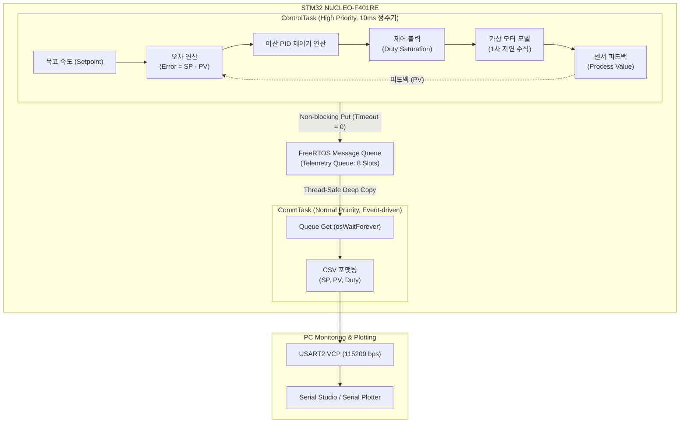

# NUCLEO-F401RE: FreeRTOS 기반 폐루프 PID 제어 시스템

STM32 NUCLEO-F401RE 보드와 FreeRTOS(CMSIS-RTOS V2)를 활용하여 정밀 주기 결정론(Determinism)을 보장하는 폐루프(Closed-Loop) PID 제어 시스템을 구축하고 단계별로 검증하는 엔지니어링 스터디 프로젝트입니다.  
물리적 모터와 센서가 부재한 환경에서도 **소프트웨어 1차 지연 플랜트 모델(Plant Simulation)**을 제어 루프에 직결하여, 임베디드 실시간 OS의 아키텍처 원리와 피드백 제어기 응답 곡선을 PC 시각화 도구로 계측·검증하도록 설계되었습니다.

---

## 🛠 개발 환경 (Development Environment)

- **Target Board**: STMicroelectronics NUCLEO-F401RE (ARM Cortex-M4 with FPU @ 84MHz, 512KB Flash, 96KB SRAM)
- **IDE / Toolchain**: STM32CubeIDE (v2.1.1) / GNU Arm Embedded Toolchain
- **OS / Middleware**: FreeRTOS (CMSIS-RTOS V2 추상화 계층 적용)
- **HAL Driver**: STM32F4xx HAL Driver (HAL Timebase: `TIM10` 전용 할당)
- **Visualization Tool**: Serial Studio / Arduino Serial Plotter (VCP UART @ 115200 bps)

---

## 📚 핵심 공학 이론 및 학습 내용 (Core Principles)

### 1. RTOS(Real-Time Operating System)의 결정론(Determinism)
RTOS는 단순한 고속 연산 라이브러리가 아니라, **"정해진 시간 제약 조건(Deadline) 내에 시스템이 항상 동일하게 응답함을 보장하는 결정론적(Deterministic) 런타임 환경"**입니다.

- **단일 물리 SRAM 공유와 스레드 제약**:
  가상 메모리(MMU) 격리 계층이 없는 MCU 환경에서는 모든 태스크가 단일 물리 RAM을 공유합니다. 따라서 전역 메모리 레이스 컨디션(Race Condition)을 원천 차단하기 위해 뮤텍스(Mutex), 세마포어(Semaphore), 또는 복사 기반의 **메시지 큐(Message Queue)**를 통한 안전한 IPC(Inter-Process Communication) 설계가 필요합니다.
- **컨텍스트 스위칭(Context Switching)의 하드웨어 메커니즘**:
  SysTick 타이머 또는 스케줄러 요청에 의해 PendSV 인터럽트가 발생하면, 현재 실행 중인 CPU 레지스터 세트(R0~R15, PC, xPSR 등)를 **해당 태스크의 독립 스택(RAM)에 푸시(Push)**하여 백업합니다. TCB(Task Control Block)의 SP(Stack Pointer)를 갱신한 후, 우선순위가 가장 높은 다른 태스크의 스택에서 레지스터를 복원(Pop)하여 실행 문맥을 전환합니다.
- **절대 주기 동기화(`osDelayUntil`)를 통한 누적 지연(Drift) 제거**:
  일반적인 상대 지연(`osDelay(T)`)은 루프 내 연산 시간 및 인터럽트 서비스 시간($T_{\text{exec}}$)이 지연 시간에 가산되어 주기마다 시간이 밀리는 누적 오차(Cumulative Drift)를 유발합니다.  
  반면 `osDelayUntil`은 기준 시점(`tick`)에 고정 주기를 누적하여 **깨어날 미래의 절대 시각**을 커널에 전달하므로, 실행 시간 변동과 관계없이 정확한 정주기성을 보장합니다.

  ```c
  uint32_t tick = osKernelGetTickCount(); // 초기 기준 시각 기록

  for (;;)
  {
      /* 1. 제어 알고리즘 및 연산 수행 (소요 시간: T_exec) */

      /* 2. 다음 목표 절대 시각 갱신 */
      tick += CONTROL_TASK_PERIOD_MS;

      /* 3. 연산 소요 시간과 무관하게 계산된 절대 시각까지 대기 (Jitter 최소화) */
      osDelayUntil(tick);
  }
  ```

### 2. 고신뢰성 임베디드 IPC 파이프라인 설계 원칙

#### ① 스냅샷 공유 구조체 (`TelemetryData_t`)
태스크 간 전역 변수를 개별 공유하면 쓰기 도중 읽기가 발생하는 비원자적(Non-atomic) 데이터 분리(Torn Read/Write) 현상이 발생합니다. 이를 방지하기 위해 계측 데이터를 하나의 독립 패킷 구조체로 캡슐화하여 큐 버퍼로 값 복사(Deep Copy)합니다.
- **ARM Cortex-M4 32비트 워드 정렬**: 모든 필드를 4바이트(uint32_t, float)로 정렬하여 구조체 내 더미 패딩 바이트(Padding Byte)가 발생하지 않도록 구성하고 메모리 복사 오버헤드를 최소화하였습니다.
- **하드웨어 FPU 활용**: `float`(단정밀도 부동소수점) 타입을 사용하여 Cortex-M4F 전용 FPU 레지스터를 통한 1~2 사이클 내 초고속 제어 연산을 지원합니다.

#### ② 데시메이션 (Decimation / Downsampling)
- **제어(Control)의 요구 조건**: 물리 플랜트의 안정성 확보를 위해 고주파수(100Hz, 10ms 주기)의 빠른 샘플링이 필수적입니다.
- **통신(Telemetry)의 병목**: 느린 I/O 전송(UART 115200bps)과 `printf` 포맷팅 연산은 큰 CPU 시간을 소모합니다.
- **해결책**: 제어 연산은 10ms마다 수행하되, 텔레메트리 큐 전송은 5회당 1회(50ms, 20Hz)로 솎아내는 데시메이션을 적용하여 통신 대역폭 포화와 큐 오버플로우를 차단합니다.

### 3. 폐루프(Closed-Loop) PID 제어와 물리 세계의 모델링
PID 제어는 물리적 관성, 지연 시간, 외부 마찰이 존재하는 실세계 시스템에서 **오차(Error = Setpoint - Process Value)를 시간 관점(현재·과거·미래)으로 분해하여 보정하는 폐루프 피드백 알고리즘**입니다.

$$u(t) = K_p \, e(t) + K_i \int_{0}^{t} e(\tau)\,d\tau + K_d \frac{de(t)}{dt}$$

- **P (Proportional, 현재 오차 비례)**: 
  현재 오차 크기에 비례한 복원력을 즉각 발생시켜 상승 시간(Rise Time)을 단축합니다.  
  *(한계: P 제어만 단독 사용 시 시스템 마찰력과 평형을 이루는 지점에서 오차가 더 이상 줄어들지 않는 정상상태 오차가 잔류합니다.)*
- **I (Integral, 과거 오차 누적)**:
  시간에 따라 잔류하는 미세 오차를 적분하여 출력을 지속적으로 증가시킴으로써 **정상상태 오차(Steady-State Error)를 0으로 강제 수렴**시킵니다. 액추에이터 포화 구간에서 적분값이 무한 누적되는 것을 방지하기 위해 **Anti-Windup(적분 포화 제한)** 알고리즘을 적용합니다.
- **D (Derivative, 미래 오차 추정)**:
  오차의 변화율(미분값, 속도)을 감지하여 목표값에 급격히 접근할 때 제동(Damping)을 걸어 **오버슈트(Overshoot)를 억제하고 안정성을 부여**합니다.

---

## 🏗 시스템 아키텍처 및 데이터 흐름도 (Data Flow)

제어 루프의 실시간성을 해치지 않기 위해 **생산자-소비자(Producer-Consumer) 패턴**을 적용하여 제어 연산과 I/O 시리얼 통신을 완전 분리했습니다.



---

## 📁 소프트웨어 모듈화 구조 (Clean Architecture)

CubeMX 코드 생성기와의 충돌을 방지하고 계층 간 의존성을 분리하기 위해 `App`, `BSP`, `Core`의 3계층 아키텍처를 채택했습니다.

```text
nucleo-rtos-pid/
├── App/                       # [순수 애플리케이션 및 제어 로직 (하드웨어 비종속)]
│   ├── Inc/
│   │   ├── app_main.h         # 시스템 초기화 인터페이스 (App_Init 선언)
│   │   ├── telemetry_def.h    # 태스크 간 IPC 공유 데이터 구조체 및 큐 핸들
│   │   ├── control_task.h     # 제어 루프 태스크 인터페이스
│   │   ├── comm_task.h        # 통신 및 로깅 태스크 인터페이스
│   │   ├── pid.h              # 순수 C 이산 PID 알고리즘 (Anti-Windup 포함)
│   │   └── plant_sim.h        # 1차 지연 모터 물리 모델 (ADC/실물 대체)
│   └── Src/
│       ├── app_main.c         # 시스템 오케스트레이터 (큐 할당 및 태스크 기동)
│       ├── control_task.c     # 10ms 주기 제어 루프 (Producer, Non-blocking Put)
│       ├── comm_task.c        # 이벤트 구동형 UART 스트리밍 (Consumer, osWaitForever)
│       ├── pid.c
│       └── plant_sim.c
│
├── BSP/                       # [보드 종속적 입출력 드라이버 래퍼]
│   ├── Inc/
│   │   ├── bsp_uart.h         # UART printf 리디렉션 및 패킷 전송
│   │   └── bsp_button.h       # 온보드 버튼(B1) 외란/타겟 스텝 입력 인터페이스
│   └── Src/
│       ├── bsp_uart.c
│       └── bsp_button.c
│
├── Core/                      # [STM32CubeMX 생성 영역 (브릿지 역할)]
│   ├── Inc/
│   │   ├── main.h
│   │   └── FreeRTOSConfig.h
│   └── Src/
│       ├── main.c             # 하드웨어 초기화 후 App_Init() 위임
│       └── stm32f4xx_it.c     # 인터럽트 서비스 루틴 (ISR)
│
├── Middlewares/Third_Party/   # FreeRTOS 커널 소스
└── Drivers/                   # CMSIS 및 STM32F4xx HAL 드라이버
```

---

## 🗺️ 단계별 구현 및 실증 기록 (Study & Verification Log)

### [x] Step 1: RTOS Baseline & Scheduling 검증
- **학습 내용**: `osDelay`의 상대 지연으로 인한 누적 오차(Drift) 위험성을 분석하고, `osDelayUntil`의 절대 시각(Absolute Time) 웨이크업 원리를 적용.
- **실측 검증**: 
  - `ControlTask`(1s 정주기, LD2 LED 토글)와 `CommTask`(2s 정주기, UART Uptime 로그) 구동.
  - `osKernelGetTickCount()` 출력을 통해 1000ms/2000ms 단위로 오차 없이 태스크가 스케줄링됨을 확인하여 RTOS 베이스라인 확보.

### [x] Step 2: Thread-Safe IPC (Message Queue) & 데시메이션 검증
- **학습 내용**: 
  - 전역 변수 공유 시 발생하는 비원자적 데이터 훼손(Torn Read/Write) 방지를 위해 16바이트 워드 정렬 구조체(`TelemetryData_t`)의 값 복사(Deep Copy) 파이프라인 구축.
  - 고속 제어 연산(100Hz, 10ms)과 느린 직렬 통신 I/O(UART 115200bps) 간 병목을 격리하기 위한 5분주 데시메이션(Downsampling, 20Hz) 기법 적용.
  - 생산자(`ControlTask`)의 비차단(`timeout = 0`) 푸시와 소비자(`CommTask`)의 이벤트 구동형 수면(`osWaitForever`) 정책 설계.

- **실측 로그 기반 1차 검증 (UART Console)**:
  ```text
  17390,100.00,26.50,25.00
  17440,100.00,29.00,25.00
  17490,100.00,31.50,25.00
  ...
  26490,100.00,120.00,25.00
  26540,100.00,2.00,25.00
  ```
  - **관측 결과**:
    1. 타임스탬프가 50ms 간격($17440 - 17390 = 50\text{ms}$)으로 일정하게 증가함을 확인하여, 5분주 다운샘플링 주기의 안정성 검증.
    2. 매 50ms마다 더미 PV 값이 정확히 2.50($0.5 \times 5$)씩 누적되고, 임계치(120.0) 도달 후 2.00으로 정상 롤오버되는 정량적 패턴 확인.

- **심층 엔지니어링 분석 및 현재 검증의 한계점 (Verification Scope & Limits)**:
  - **1ms 단위 해상도의 한계**: 현재 타임스탬프는 FreeRTOS 1kHz 틱(`osKernelGetTickCount`) 기준이므로, $10.x\,\text{ms}$ 수준의 마이크로초($\mu\text{s}$) 단위 미세 지터(Jitter)는 정수 절삭으로 인해 로그상에서 완벽히 증명되지 않음 *(향후 Cortex-M4 코어 내부의 DWT 하드웨어 사이클 카운터(DWT->CYCCNT)를 활용하여 마이크로초($\mu\text{s}$) 단위 실측 및 실행 시간(WCET) 계측으로 보완 예정)*.
  - **중간 제어 루프의 간접 유추**: 50ms 시점의 패킷만 수신하므로 1~4번째 제어 루프의 실행 지연 발생 여부는 간접 유추에 의존함.
  - **큐 드롭 및 패킷 무결성 식별 한계**: 현재 `osMessageQueuePut`의 리턴값을 무시하고 있어 통신 지연 시 큐 포화(Drop) 발생 여부를 수치로 감지하지 못하며, 시퀀스 번호(`seq_num`)의 부재로 수신 측에서의 단일 패킷 유실을 수학적으로 완전 증명하기 어려움.
  - **도출된 개선 과제**: 향후 시스템 고도화 단계에서 `seq_num`(패킷 손실 검증), `queue_drop_count`(오버플로우 검증), 루프별 실행 지연 감지 플래그를 구조체에 추가하여 100% 무결성 진단 파이프라인으로 확장 계획.

### [ ] Step 3: Virtual Plant Simulation (Open-Loop)
- **학습 내용**: DC 모터의 1차 지연 전달함수($G(s) = \frac{K}{\tau s + 1}$)를 오일러 후진 차분법(Euler Method)으로 이산화하는 수학적 원리 학습.
- **검증 계획**: 스텝 입력(Duty 50%)을 인가했을 때, 시상수 $\tau$에 도달하는 시점(최종값의 63.2%)을 로그와 그래프로 측정하여 물리 법칙 일치 여부 확인.

### [ ] Step 4: Closed-Loop PID Control & Gain Tuning
- **학습 내용**: P, I, D 각 게인이 상승 시간, 정상상태 오차, 오버슈트에 미치는 영향과 Anti-Windup의 필요성 체득.
- **검증 계획**: Serial Studio를 통해 Setpoint 변경 시 PV가 목표치에 도달하는 계측 곡선을 실시간으로 캡처하여 최적 게인 도출 과정 기록.

### [ ] Step 5: Edge Case & Optimization
- **학습 내용**: 하드웨어 인터럽트(B1 버튼 외란)가 실시간 제어 루프에 미치는 영향 분석 및 유휴 시간 저전력 설계.
- **검증 계획**: 온보드 버튼을 통한 실시간 외란 입력 시 PID의 회복 거동 계측 및 WFI 저전력 모드 연동 검증.
